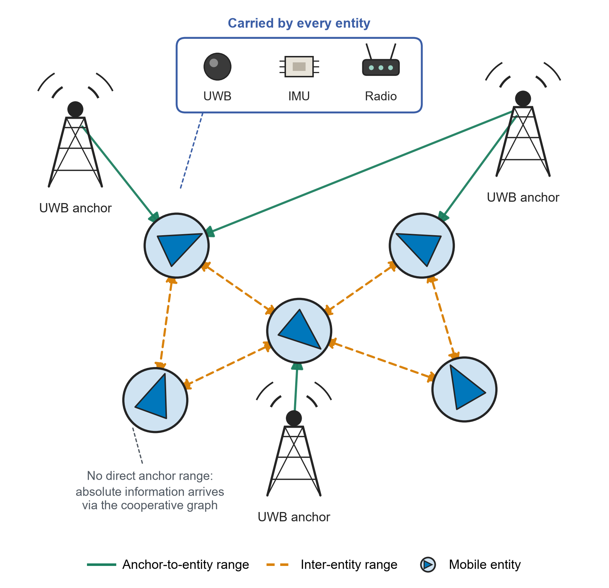

# TL-ESKF: Two-Level Covariance ESKF for UWB/IMU Cooperative Localization

Python simulation code associated with the manuscript **“Measurement-Sensitive Two-Level Covariance ESKF for UWB/IMU Cooperative Localization”** by Hao Chang, Yonghui Huang, Yuanyuan Jiang, and Zhugang Wang.

> **Release status:** Source-code preparation from an author-supplied archive. A short smoke test has been performed; full Monte Carlo reproduction and figure-by-figure numerical agreement with the manuscript have **not** yet been independently verified. See [release notes](RELEASE_NOTES.md).

## Summary

TL-ESKF keeps the complete 15-dimensional inertial error-state covariance locally for each entity while maintaining a joint 3K-dimensional position covariance for cooperative UWB ranging updates. The project includes the proposed TL-ESKF and simulation baselines: centralized ESKF, covariance intersection (CI), a local-only decentralized cooperative localization (DCL) implementation, UWB-only and IMU-only.



## Repository layout

```text
TL-ESKF/
├── README.md                Project description and reproduction guide
├── RELEASE_NOTES.md         Differences from uploaded development archive
├── requirements.txt         Python dependencies
├── .gitignore
├── src/
│   ├── config.py
│   ├── l1_*.py               Simulation, process, sensing and math utilities
│   ├── l2_*.py               Estimators including TL-ESKF and baselines
│   ├── l3_runner.py          Simulation engine
│   ├── run_large_scale_parallel.py  Paper-oriented experiment runner
│   ├── collect_results.py    Convert run outputs into analysis tables
│   └── plot_paper_figures_publication_v2.py   Publication plots
├── docs/                    Experiment runbooks and notes
└── assets/                  Scenario illustration
```

## Environment

Python 3.11+ is recommended; the original supplied archive contained Python 3.13 bytecode. The smoke test for this release used Python 3.13 with NumPy 2.3.5, SciPy 1.17.0, Pandas 2.2.3 and Matplotlib 3.10.8. The original NumPy and SciPy pins are retained in `requirements.txt`; plotting dependencies have been added.

From the repository root:

```bash
python -m pip install -r requirements.txt
cd src
```

## Minimal test (not a paper-quality experiment)

This runs only the nominal condition C008 with one seed and a shortened duration:

```bash
python run_large_scale_parallel.py --conditions C008 --seeds 1010 --duration 2 --burn-in 0.5 --workers 1 --disable-diagnostics --output results_smoke
python collect_results.py --results-root results_smoke --output analysis_smoke --level core --bundle
```

The real paper experiments are significantly more computationally demanding. Do not compare smoke-test numbers with manuscript tables.

## Full experiment and figures

The manuscript's nominal condition is 10 entities with anchor-availability composition A/B/C = 2/6/2, a complete ranging graph, 120 s simulation duration, 20 s burn-in, an IMU period of 0.005 s and a UWB period of 0.10 s. The nominal condition uses 50 Monte Carlo seeds.

To run the full condition suite using the runner defaults (large CPU workload):

```bash
python run_large_scale_parallel.py --workers 8 --output results_experiment_v2
python collect_results.py --results-root results_experiment_v2 --output analysis_tables --level core --bundle
python plot_paper_figures_publication_v2.py --tables analysis_tables --output paper_figures
```

To inspect the planned scenario list without running it:

```bash
python run_large_scale_parallel.py --dry-run --workers 1 --output results_dry_run
```

The paper-oriented runner uses `K = 5, 10, 20, 30` for the network-size experiment. This version was supplied as a separate `run_large_scale_parallel_K30_replacement.py` in the input archive and is promoted to the canonical runner here. See the release notes. Some development runbooks may describe earlier experiment variants; use the commands above as the starting point.

### Primary source files

- `src/l2_dual_layer.py`: proposed TL-ESKF
- `src/l2_centralized_eskf.py`: centralized baseline
- `src/l2_ci_eskf.py`: CI baseline
- `src/l2_local_only.py`: local-only/DCL baseline
- `src/l2_uwb_only.py`, `src/l2_imu_only.py`: sensor ablations
- `src/run_large_scale_parallel.py`: experiment conditions and batch execution
- `src/collect_results.py`: result aggregation
- `src/plot_paper_figures_publication_v2.py`: figure preparation

## Citation

Please cite the manuscript associated with this code. DOI, journal status and BibTeX metadata can be added after they have been confirmed. An unverified publication identifier is intentionally omitted.

## License

**License selection pending.** Before making this repository public for reuse, confirm the rights of all contributors and choose an appropriate `LICENSE` file. Public visibility alone does not grant permission to reuse code.

## Important limitations

- The archive does not include the complete full-scale Monte Carlo outputs; full numerical reproduction requires running the experiments.
- The manuscript PDF is not included in this repository package because manuscript distribution should be considered separately from source-code publication.
- The project is simulation code, not a validated hardware localization implementation.
